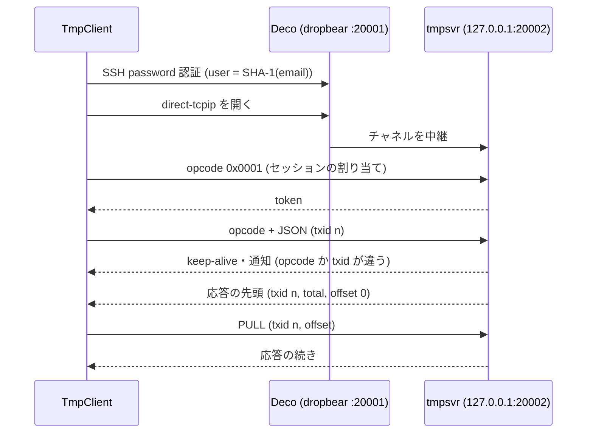
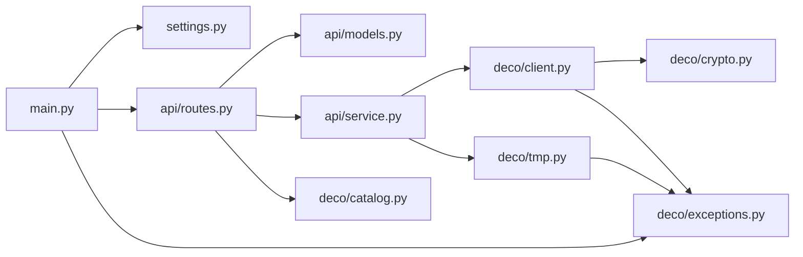

# Deco BE85 API

[](https://github.com/msageha/tplink-deco-be85-api/actions/workflows/ci.yaml)

TP-Link Deco BE85 のローカル Web API (Deco アプリが内部で叩いている API) を
FastAPI + Pydantic でラップした REST サーバーです。ステータス取得や Wi-Fi の
ON/OFF などをローカルネットワークから操作できます。

## セットアップ

このリポジトリは [mise](https://mise.jdx.dev/) の利用を前提としています。

```bash
mise trust    # 初回のみ: このディレクトリの mise.toml を信頼する
mise install  # ツールをインストールし、uv sync と git hooks のセットアップを行う
```

`mise install` を実行すると `[hooks] postinstall` により `uv sync --locked` (依存関係を `.venv` に入れる) と
`prek install` (`.git/hooks/pre-commit`・`.git/hooks/pre-push`・`.git/hooks/commit-msg` の登録) が自動実行されます。
`.pre-commit-config.yaml` の hook 構成が変わったあとの既存 clone では `mise exec -- prek install` を再実行してください。

以前 `uv run pre-commit install` で hook を登録していた clone では、`mise exec -- prek install --force` で
旧 hook を置き換えてください。置き換えないと prek が旧 hook (`.git/hooks/pre-commit.legacy`) も実行し、
`uv sync` で削除された pre-commit package を呼んで commit が失敗します。

Deco の管理パスワード (TP-Link ID のパスワード) と、Deco のオーナーの TP-Link ID の email は
[fnox](https://fnox.jdx.dev/) で age 暗号化し、`fnox.toml` の `PASSWORD` と `TPLINK_EMAIL` に保存しています。
`mise run dev` / `mise run run-image` は `fnox exec` で復号した値を同名の環境変数としてアプリに渡し、
復号できなければ起動しません。email は Deco アプリと同じ経路 (TMP、後述) の SSH の認証に使います。
`fnox.toml` に `TPLINK_EMAIL` が無い checkout では、次の手順で登録するまで `mise run dev` / `mise run run-image` は
起動しません。

復号に使う age の秘密鍵は、リポジトリ管理者の 1Password (`Private` vault の `age-identity`) から
[1Password CLI](https://developer.1password.com/docs/cli/) (`op`) で読みます。`op` をインストールしてサインインしておいてください。
復号のたびに 1Password の承認 (Touch ID 等) を求められることがあります。

値を登録・変更するときは、リポジトリ管理者が次のコマンドを実行します (入力は表示されません)。`-c ./fnox.toml` は
`fnox.local.toml` を読まずに `fnox.toml` の鍵で暗号化させるために付けます。`fnox.toml` には既定の provider が無く、
`--provider age` を付けずに新しいキーを登録すると、値が平文で保存されます。

```bash
mise exec -- fnox -c ./fnox.toml set PASSWORD --provider age
mise exec -- fnox -c ./fnox.toml set TPLINK_EMAIL --provider age
```

`fnox.toml` の暗号文はリポジトリ管理者の鍵でしか復号できません。ほかの環境では、git 管理外の `fnox.local.toml` に
自分の age の公開鍵と秘密鍵の場所を書き、そこへ `PASSWORD` と `TPLINK_EMAIL` を登録します。`fnox.local.toml` の値は `fnox.toml` より優先されます。

```bash
mkdir -p ~/.config/fnox
mise x age -- age-keygen -o ~/.config/fnox/deco.txt   # 表示された公開鍵 (age1...) を下の recipients に書く
cat > fnox.local.toml <<'TOML'
[providers.age]
type = "age"
recipients = ["<age-keygen が表示した公開鍵>"]
key_file = "~/.config/fnox/deco.txt"
TOML
mise exec -- fnox -c ./fnox.local.toml set PASSWORD --provider age
mise exec -- fnox -c ./fnox.local.toml set TPLINK_EMAIL --provider age
```

接続先の Deco の URL (`DECO_HOST`) と、Deco の TMP (SSH) の host key (`TMP_HOST_KEY`) は `mise.toml` の `[env]` で
設定します。`TMP_HOST_KEY` は `known_hosts` と同じ `<鍵の種類> <base64>` の形で、Deco と同じ LAN から
`ssh-keyscan -p 20001 -t ecdsa <Deco のアドレス>` を実行し、出力の 2 列目と 3 列目を使います。Deco は RSA の鍵も
持ちますが、SHA-1 の署名 (`ssh-rsa`) でしか提示しないので使えません。API はこの鍵と一致しない接続先には TP-Link ID のパスワードを送りません。
Deco の鍵が変わったときは、`/api/app/...` は 502 を返し、`detail` に提示された鍵の種類と fingerprint が出ます。
その場合は鍵を取り直して登録し直してください。ほかの設定値にはアプリ側に既定値があり、変えるときだけ環境変数で渡します。

| 変数         | 既定値  | 説明                                       |
| ------------ | ------- | ------------------------------------------ |
| `ACCOUNT`    | `admin` | 署名 hash に使うローカル管理アカウント名   |
| `VERIFY_SSL` | `false` | HTTPS 時に証明書を検証するか               |
| `TIMEOUT`    | `30`    | ルーターへの HTTP・TMP のタイムアウト (秒) |
| `TMP_PORT`   | `20001` | Deco の TMP (SSH) の port                  |

## 起動

```bash
mise run dev   # PASSWORD と TPLINK_EMAIL を fnox で復号し、uvicorn を --reload 付きで起動する
```

- Swagger UI: http://127.0.0.1:8000/docs
- ルーターへのログインは遅延 (最初の API 呼び出し時)。401/403 やログイン画面 (非 JSON) が
  返ったら自動で再ログインして 1 回だけ再送します。
- TMP の SSH セッションも最初の `/api/app/...` の呼び出しで張り、使い回します。切れていたら次の呼び出しで張り直します。
- luci と TMP のクライアントはセッション状態を持つため、それぞれのリクエストはサーバー側の lock で直列化されます。

### Docker

```bash
mise run build-image   # docker build -t deco-be85-api:latest .
mise run check-image   # build し、ダミーの設定・read-only で起動して /api/health が応答するのを確かめる (CI の image job と同じ)
mise run run-image     # PASSWORD と TPLINK_EMAIL を fnox で復号し、環境変数を渡して docker run する
```

ランナーは shell やパッケージマネージャを持たない distroless (`gcr.io/distroless/cc-debian13:nonroot`) です。
distroless には Python 3.14 のイメージが無いので、ビルダで uv が配布する Python を入れ、実行時に使わないファイル
(tcl/tk・pip・ヘッダ等) を除いてからランナーへ写します。

- UID 65532 の非 root で動きます。root filesystem を read-only にし、capability をすべて外しても動くので、
  `mise run run-image` はその設定 (`--read-only --cap-drop ALL --security-opt no-new-privileges`) で起動します。
  docker compose では `read_only: true`・`cap_drop: [ALL]`・`security_opt: [no-new-privileges:true]` が同じ設定です。
- shell が無いので、`docker exec <container> sh` では入れず、shell を前提にしたコマンド (compose の healthcheck の
  `CMD-SHELL`、`command` の中のパイプや変数展開等) も動きません。compose の `healthcheck.test` は exec 形式で Python を呼びます
  (例: `["CMD", "python", "-c", "import urllib.request; urllib.request.urlopen('http://127.0.0.1:8000/api/health')"]`)。
  中を調べるときは `docker run --rm --entrypoint python deco-be85-api:latest -c '<code>'` で起動します。
- `PASSWORD`・`TPLINK_EMAIL`・`DECO_HOST`・`TMP_HOST_KEY` はイメージに含めず、実行時に環境変数で渡します。mise を
  使わずに起動する場合 (docker compose 等) は、この 4 つを直接渡せば fnox は要りません。

## エンドポイント

| Method | Path                                       | 説明                                            |
| ------ | ------------------------------------------ | ----------------------------------------------- |
| GET    | `/api/health`                              | サーバー状態とログイン状況                      |
| POST   | `/api/login`                               | 明示ログイン                                    |
| POST   | `/api/logout`                              | ログアウト                                      |
| GET    | `/api/dashboard`                           | 概況 (回線 / CPU / メモリ / Deco 台数 / 接続数) |
| GET    | `/api/devices`                             | Deco ユニット (メッシュノード) 一覧             |
| GET    | `/api/clients`                             | 接続クライアント一覧 (`?online_only=true`)      |
| GET    | `/api/clients/blocked`                     | ブロック中クライアント一覧                      |
| GET    | `/api/network/wan`                         | WAN IPv4 ステータス                             |
| GET    | `/api/network/internet`                    | インターネット接続情報 (IPv4 / IPv6)            |
| GET    | `/api/network/lan`                         | LAN / DHCP DNS / WAN IP                         |
| GET    | `/api/network/ipv6`                        | IPv6 有効状態                                   |
| GET    | `/api/network/performance`                 | CPU / メモリ使用率                              |
| GET    | `/api/network/mac-clone`                   | MAC クローン設定                                |
| GET    | `/api/network/wan-mode`                    | WAN ポートの動作モード                          |
| GET    | `/api/network/dhcp-dial`                   | WAN の DHCP 接続設定 (unicast)                  |
| GET    | `/api/network/igmp`                        | IGMP (マルチキャスト) 設定                      |
| GET    | `/api/network/fast-xmit`                   | fast xmit の有効状態                            |
| GET    | `/api/network/vlan`                        | VLAN (IPTV) 設定                                |
| GET    | `/api/network/ddns`                        | DDNS の有効状態とドメイン                       |
| GET    | `/api/wireless`                            | Wi-Fi 設定の取得                                |
| POST   | `/api/wireless`                            | バンド別 Wi-Fi の ON/OFF                        |
| POST   | `/api/wireless/config`                     | Wi-Fi 設定変更 (SSID / パスワード / enable 等)  |
| GET    | `/api/wireless/power`                      | 電波 (DFS サポート等)                           |
| GET    | `/api/wireless/beamforming`                | beamforming の有効状態                          |
| GET    | `/api/wireless/operation-mode`             | 無線の動作モード (AP / router)                  |
| GET    | `/api/wireless/bridge`                     | ブリッジ / PLC 状態                             |
| GET    | `/api/wireless/roaming`                    | 802.11r 高速ローミングの有効状態                |
| GET    | `/api/wireless/bandwidth`                  | 160MHz 幅 (HT160) の有効状態                    |
| GET    | `/api/device/mode`                         | 動作モード (region / workmode / sysmode)        |
| GET    | `/api/device/time`                         | 時刻・タイムゾーン設定                          |
| GET    | `/api/device/speedtest`                    | 直近のスピードテスト結果                        |
| GET    | `/api/cloud/device-info`                   | クラウド連携情報 (model / role 等)              |
| GET    | `/api/cloud/login-status`                  | TP-Link ID のログイン状態                       |
| GET    | `/api/system/component-info`               | ERP / 省電力等のコンポーネント情報              |
| GET    | `/api/system/switch-list`                  | UI 機能スイッチ                                 |
| GET    | `/api/system/log-types`                    | ログ種別 (`/api/system/log` の `level`)         |
| GET    | `/api/system/log`                          | システムログ (`?level=&index=&limit=`)          |
| GET    | `/api/system/firmware`                     | ファームウェア更新の有無 (cloud に問い合わせ)   |
| POST   | `/api/reboot`                              | Deco の再起動 (`confirm=true` 必須)             |
| POST   | `/api/raw`                                 | 任意エンドポイントへの汎用パススルー            |
| POST   | `/api/luci/<module>/<form>/<operation>`    | luci の Web API の 1 操作 (後述)                |
| POST   | `/api/app/<controller>/<form>/<operation>` | Deco アプリの経路 (TMP) の 1 操作 (後述)        |

モデル (`DecoNode` 等) を定義している endpoint 以外は、ルーターの応答をそのまま返します
(フィールドはファームウェアで異なりうる)。モデル化した endpoint も主要フィールドだけを定義し、
未知のフィールドは保持して返します (`extra="allow"`)。

### エラー

| Status    | 意味                                                                                                                      |
| --------- | ------------------------------------------------------------------------------------------------------------------------- |
| 400 / 422 | リクエスト検証エラー (`confirm` 無し、未知の `settings` フィールド等)                                                     |
| 401       | ルーターへのログイン失敗 (`DecoAuthError`。TMP は email かパスワードの不一致)                                             |
| 413       | `/api/app/...` の `params` が TMP の 1 packet に収まらない                                                                |
| 502       | ルーターがエラーや不正な応答を返した (`detail` と `error_code`)。TMP の host key が `TMP_HOST_KEY` と一致しないときも 502 |
| 504       | ルーターに到達できない (`DecoConnectionError`)                                                                            |

422 の `detail` はどの項目がなぜ不正かを返し、送った値 (パスワード等) は含めません。

### Wi-Fi トグル例

```bash
curl -X POST http://127.0.0.1:8000/api/wireless \
  -H 'Content-Type: application/json' \
  -d '{"band":"band5_1","network":"host","enable":false}'
```

`band` は `band2_4` / `band5_1` / `band6`、`network` は `host` / `guest` (enum で検証)。

### Wi-Fi 詳細設定の変更 `/api/wireless/config`

`admin/wireless?form=wlan` への `operation:write`。`band` × `network` (host / guest) ごとに
`enable` / `ssid` / `password` / `enable_hide_ssid` / `channel` / `channel_width` / `mode`
を指定できます (指定したフィールドのみ送信)。`ssid` / `password` は**平文で渡すと内部で
base64 エンコード**します (ルーターは base64 で保持するため)。

```bash
# ゲスト Wi-Fi の SSID とパスワードを変更
curl -X POST http://127.0.0.1:8000/api/wireless/config \
  -H 'Content-Type: application/json' \
  -d '{"band":"band5_1","network":"guest","settings":{"enable":true,"ssid":"My Guest","password":"secretpass"}}'
```

> Wi-Fi 設定の変更は接続中クライアントに一時的な影響があります。`settings` は未知フィールドを
> 拒否 (`extra="forbid"`) し、最低 1 項目の指定が必須です。設定値は `GET /api/wireless` の構造
> (`band.host` / `band.guest`) に対応します。

### システムログ `/api/system/log`

`admin/log_export?form=feedback_log` を `operation:build` → `operation:read` の順に呼びます
(Web UI と同じ手順。build でルーター側に level で絞ったスナップショットを作らせる)。

```bash
curl 'http://127.0.0.1:8000/api/system/log?level=3&index=0&limit=100'
```

- `level`: `/api/system/log-types` の `value` (1 ALERT 〜 7 DEBUG、8 ALL。既定 8)。その重要度までを含む
- `index`: 0 始まりのページ番号 (既定 0)
- `limit`: 1 ページの件数 (既定 100)
- 応答: `{"totalNum": <limit での総ページ数>, "currentIndex": <index>, "logList": [{"content": "..."}]}`

### ファームウェア更新チェック `/api/system/firmware`

`admin/cloud?form=firmware_status` の `operation:check` で TP-Link cloud に問い合わせ、ノードごとの
`software_ver` / `new_version` / `need_to_upgrade` などを返します (数秒かかる)。更新の適用
(`operation:download` / `upgrade`) は提供しません。

### 汎用パススルー `/api/raw`

任意の Deco エンドポイントを直接叩けます。レスポンスは復号済みのエンベロープ全体
(`result` / `error_code` または `success` / `data`) をそのまま返します。ルーターが
エンベロープでエラーを返しても 200 で返し、呼んだ endpoint の HTTP エラーや不正な応答は 502 にします
(ログインや通信の失敗は「エラー」の表のとおり 401 / 504)。

```bash
curl -X POST http://127.0.0.1:8000/api/raw \
  -H 'Content-Type: application/json' \
  -d '{"path":"admin/client?form=client_list","operation":"read","params":{"device_mac":"default"}}'
```

- `path`: `admin/<module>?form=<form>` 形式の相対パス (英数字と `_`、`/`、1 つの `?form=` のみ)
- `operation`: `read` / `write` / `load` / `list` / `get` / `set` / `add` / `edit` / `remove` / `operate` / `check` / `build` (enum)
- `params`: 任意の追加パラメータ (省略可)

> `operation: write` と適切な `params` を渡すと設定を変更できる強力な口です。

### luci・Deco アプリの操作 `/api/luci/...`・`/api/app/...`

ルーターが受け付ける操作を、1 操作 1 endpoint で呼べます。一覧は FW 1.3.0 のイメージから復元したもので
(後述)、`/docs` に module・controller ごとの tag で並びます。

- `POST /api/luci/<module>/<form>/<operation>`: luci の Web API (`admin/<module>?form=<form>`。`locale` だけは
  `admin/` が付かない) を、その operation で呼びます。
- `POST /api/app/<controller>/<form>/<operation>`: Deco アプリと同じ経路 (TMP) で、その操作の opcode を呼びます。
  luci には無い機能 (ポートフォワード・DHCP の lease・HomeShield・QoS・Wi-Fi のスケジュール・VPN・LED 等) はこちらにあります。

本文の `params` はルーターへそのまま渡し (省略可)、成功応答の本体 (`result` / `data`) を返します。ルーターがエラーを
返したら 502 です。各 endpoint の OpenAPI には、呼ぶ form (`x-deco-luci-path`) か opcode (`x-deco-tmp-opcode`)、
operation (`x-deco-operation`)、破壊的操作か (`x-deco-destructive`) を載せています。

```bash
# DHCP の予約の一覧 (luci)
curl -X POST http://127.0.0.1:8000/api/luci/client/addr_reservation/getlist -H 'Content-Type: application/json' -d '{}'
# ポートフォワードの一覧 (Deco アプリの経路)
curl -X POST http://127.0.0.1:8000/api/app/nat/vs/getlist -H 'Content-Type: application/json' -d '{}'
```

Deco 自体やネットワーク全体に届かなくなる操作 (再起動・初期化・ファームウェアの更新・WAN の切断・LAN・WAN・mesh・
IPTV の接続設定やポートの媒体・動作モード・メインノード・mesh グループの変更) と、元に戻せない操作 (ノードや cloud の紐付けの変更・
管理アカウントや TP-Link ID の変更・ログ・履歴・レポート・メッセージの消去) は、`/api/reboot` と同じく `confirm: true` が必須です
(`false` は 400、欠落や型違いは 422)。Wi-Fi や VPN など、この API から設定し直せる個別の設定の変更は、
`/api/wireless` と同じく確認なしで実行します。

- この API は `params` を検証せずにそのまま送ります。必要な項目と制約は操作とファームウェアごとに異なり、
  ルーターが受け付けない値はルーターのエラー (502) になります。設定の write は、同じ form の read の応答が
  形の手がかりになります。
- OpenVPN のプロファイルの追加・更新 (`/api/app/vpn_client/server/insert`・`update`) は、設定ファイルが
  ルーターにアップロード済みであることを前提にします。この API はファイルを送れないので、OpenVPN は
  Deco アプリで設定してください。
- TMP の write の後、ルーターは設定を反映する間 TMP の port を閉じることがあります。
  その間の `/api/app/...` は 504 になります。ルーターがセッションを切った直後の要求も、送った後に切断を
  知るので 504 になることがあり、その要求は再送しません (次の要求で接続し直します)。
- TMP の要求は 1 つの packet (本文は約 64 KiB まで) で送るので、それを超える `params` は 413 です。
- 応答はルーターが保存している値をそのまま返します。Wi-Fi・PPPoE・VPN (WireGuard の鍵を含む)・ゲストの
  ポータルなどのパスワードや鍵も含みうるので、API を公開する範囲に注意してください。
- 一覧に含めないもの: ログイン前の手順、mesh のノード間の処理、debug 用の opcode、multipart やファイルの
  送受信を前提とする form (設定のバックアップ・復元、ファームウェアの upload)、管理パスワードや cloud の
  token を返す read。

### 再起動例 (破壊的操作)

```bash
curl -X POST http://127.0.0.1:8000/api/reboot \
  -H 'Content-Type: application/json' -d '{"confirm":true}'
```

`confirm` は JSON の `true` のときだけ再起動し、`false` は 400、欠落や `"true"`・`1` などの型違いは 422 です。
`macs` で再起動するノードの MAC を指定でき、省略・`null`・空の配列なら全ノードを再起動します。

## 開発

Python は 3.14 以上で、使う minor version は `.python-version` で固定しています。uv は手元・CI・Docker イメージの build の
どれでもこのファイルから Python を選びます。Python のツールチェーンは uv (依存関係と Python 本体)、ruff (lint + formatter)、
ty と pyright (型チェック)、import-linter (層の依存の検査)、pytest で、ruff・ty・pyright は strict に設定しています。
Python の依存は、`pyproject.toml` の `[[tool.uv.index]]` で宣言した `https://pypi.flatt.tech/simple/` から取得します。
この宣言は `UV_INDEX_URL` やユーザー設定の index より優先されるので、`uv.lock` の取得元は環境によらず同じになります。
ただし `UV_DEFAULT_INDEX` はこの宣言より優先されるので、設定すると `uv.lock` と食い違います。
それ以外のツールは `mise.toml` の `[tools]` で exact version に pin し、`mise.lock` でプラットフォームごとの
URL / checksum を固定しています。CI (`ci.yaml`) もローカルも同じ `mise.lock` からツールを解決するため、
同じ検証をローカルで再現できます。タスクの一覧は末尾の「[タスク](#タスク)」を参照してください。

```bash
mise run format                          # import の並べ替え + ruff format
mise run lint                            # ruff check + ruff format --check + lint-imports + ty check + pyright
mise run test                            # coverage run -m pytest (並列) + report (オフライン。実機には触れません)
mise run pre-commit                      # pre-commit stage の hook を全追跡ファイルに対して実行する (CI の Run prek step と同じ)
mise exec -- gitleaks git --redact -v .  # コミット履歴全体のシークレットスキャン (CI の gitleaks job と同じ)
```

- [prek](https://github.com/j178/prek): pre-commit hook の実行基盤。hooks は `.pre-commit-config.yaml` で定義します。
  Python のファイルや設定が変わったとき、commit 時に `ruff-isort` / `ruff-format` hook が commit するファイルの
  import を並べ替えて整形し (未追跡のファイルは書き換えません)、`lint` hook が `mise run lint` を、push 時に `lint` hook と
  `test` hook が `mise run lint` / `mise run test` を実行するので、手元の `mise run` と同じ検査になります。hook は push する commit ではなく作業ツリーを検査する手元の事前検査で、push した変更の
  最終的な判定は PR の CI が行います。ファイルを書き換える hook (整形・README のタスク一覧の同期等) は commit 時だけに
  実行し、push 時は検査だけを行います (作業ツリーの次の作業のファイルを書き換えないため)。
  ruff / ty / import-linter は `uv run --locked` で動かし、バージョンは `uv.lock` に一元化しています。
  pyright は npm で配布されるので、`mise.toml` に node と合わせて pin しています。
  main への commit は `no-commit-to-branch` hook が止めます (main は PR 必須)。この hook は実際の commit 時だけに効かせ、
  検証用の `mise run pre-commit` では実行しません (main を checkout したままでも検証できるようにするため)。
- [import-linter](https://import-linter.readthedocs.io/): `pyproject.toml` の `[tool.importlinter]` の契約で、
  `deco` が `api`・`main`・`settings` に依存しないこと、各パッケージ内の層の向き、`api` と `deco` の中で外部ライブラリ
  (fastapi・Crypto・requests) を直接 import できるモジュールを検査します (`mise run lint` の中で実行)。
  `src` 直下の `main.py` と `settings.py` は package ではないので、自身の import は検査の対象外です。
- [dprint](https://dprint.dev/): json / markdown / toml / yaml / Dockerfile のフォーマッタ (`dprint-fmt` hook)。
  plugin の WASM URL は `dprint.json` に `url@sha256` の checksum 付きで pin します。`uv.lock` / `mise.lock` / `.mise/locks/` は対象外。
- [actionlint](https://github.com/rhysd/actionlint): workflow の静的検査 (`actionlint` hook)。
  `run:` スクリプトの検査に [shellcheck](https://github.com/koalaman/shellcheck) を使います。actionlint は PATH に
  shellcheck が無いとその検査を黙って省くため、ローカルと CI で結果が変わらないように mise で pin しています。
- [hadolint](https://github.com/hadolint/hadolint): `Dockerfile` の静的検査 (`hadolint` hook)。`.hadolint.yaml` で
  style を含む全 severity を失敗にし、ベースイメージの registry を docker.io / ghcr.io / gcr.io に限り、
  OCI label (`org.opencontainers.image.source` / `licenses`) を必須にしています。Dockerfile 内の
  `# hadolint ignore=` は無効にしているので、除外が要るときは `.hadolint.yaml` の `ignored` に書きます。
- [typos](https://github.com/crate-ci/typos): 英単語の typo 検査 (`typos` hook)。`typos.toml` で綴りを米国英語に
  統一し、生成物の `uv.lock` / `mise.lock` / `.mise/locks/` を対象外にしています。誤検知は `typos.toml` の `[default.extend-words]`
  で単語ごとに、外部ツールの option 名のように綴りを変えられない識別子は `[default.extend-identifiers]` で識別子ごとに除外します。`[files] extend-exclude` でファイルごと外すのは、生成物のように中身を直せないファイルだけです。
- [zizmor](https://docs.zizmor.sh/): workflow と `.pre-commit-config.yaml` のセキュリティ監査。`zizmor` hook と
  `mise run zizmor` が同じ設定で実行し、false positive になりうるものを含む全 finding と、解析できない入力を
  失敗にします。GitHub API を使う online audit (impostor-commit 等) は、環境変数 `ZIZMOR_GITHUB_TOKEN` /
  `GH_TOKEN` / `GITHUB_TOKEN` のどれかに token があるときだけ走ります。token が無いと offline の audit だけで
  成功するため、CI の `prek` job は prek の前に token を渡した専用 step で実行します。ローカルで CI と同じ範囲を
  監査するには、`gh` にログインした状態で `ZIZMOR_GITHUB_TOKEN=$(gh auth token) mise run zizmor` を実行します。
  出力に `running in offline mode` の warning が出たら token が渡っておらず、online audit は走っていません。
  誤検知は該当行の `# zizmor: ignore[<audit 名>]` コメントで除外します。
- [gitleaks](https://github.com/gitleaks/gitleaks): シークレットスキャン。pre-commit hook (`gitleaks` hook) が
  staged 差分を、CI の `gitleaks` job がコミット履歴全体を対象にします。
- [commitlint](https://commitlint.js.org/): commit message を
  [Conventional Commits](https://www.conventionalcommits.org/) で検査する commit-msg hook (`commitlint` hook)。
  ルールは `commitlint.config.mjs`。prek が node と依存を隔離環境へ自前で用意します。
- [fnox](https://fnox.jdx.dev/): secret manager。`PASSWORD` を age で暗号化して `fnox.toml` に持ちます。`[daemon]` は解決済みの secret をメモリに
  キャッシュする daemon を有効化し、`idle_timeout` (12h) 無操作で終了させる設定です。

`.gitignore` はホワイトリスト方式 (`*` で全て無視し、`!` で許可したものだけを追跡する) です。
新しく追跡したいファイルを追加する場合は、対応する `!` の行を追記してください。

### mise.toml / mise.lock を手で変更するとき

`mise.toml` の `[tools]` を手で変更したら `mise lock` を実行して `mise.lock` を追従させ、両方を同じ commit に
含めます。npm: backend のツール (pyright) は、`mise.lock` が依存の lock を `.mise/locks/` の下のファイル (sidecar) で
参照するので、`.mise/locks/` の差分も同じ commit に含めます (参照先は `mise lock --sidecars` で確認できます)。CI の mise-action は `mise.lock` があると `mise install --locked` でインストールするため、`mise.lock` が
古いままだと CI の各 job で失敗します。

### 依存関係の更新 (Renovate)

`renovate.json` で以下を Renovate に任せています。

- `pyproject.toml` の依存バージョンと `uv.lock` の更新、`uv.lock` の週次再解決 (`lockFileMaintenance`)。
- `mise.toml` のバージョン bump と、それに伴う `mise.lock` と `.mise/locks/` (pyright の依存の lock) の更新 (同じ PR で行われる)。
  `.mise/locks/` の `package.json` は mise lock の生成物なので、npm manager の対象から外しています
  (npm manager が別に更新すると、`mise.toml` の pin や `aube-lock.yaml` とずれるため)。
- `.pre-commit-config.yaml` の hook `rev` と、`language: node` の hook の `additional_dependencies`。
- workflow の `uses:` の commit SHA (バージョンはコメントで併記し、Renovate が両方を更新する)。
- `dprint.json` の plugin URL と checksum (`customManagers`)。
- `Dockerfile` のベースイメージ。uv は tag (uv の版) と digest、distroless は `nonroot` tag の digest を更新します。
  - イメージの Python の patch version (と Python に同梱の OpenSSL 等) は uv の版で決まり、新しい Python の配布物を収録した uv の版に
    上がったときに更新されます (uv の更新がいつも Python を変えるわけではありません)。
  - Renovate の docker datasource が公開日時を取得できるのは Docker Hub だけで、GHCR・GCR のこの 2 つは `minimumReleaseAge` を
    判定できません。公開日時が無い更新は 7 日の猶予期間を置かずに出します (`minimumReleaseAgeBehaviour: timestamp-optional`)。
  - uv の minor / patch は他の依存と同じ PR で自動マージされます。tag を変えない digest の更新 (distroless の OS パッケージの修正等) は
    別の PR になり、人手で merge します。

次は Renovate の対象外で、手で書き換えます。

- Python の minor version (`.python-version`)。依存とツールが新しい minor に対応したのを確かめてから上げます
  (`renovate.json` で pyenv manager を無効にしています)。
- distroless の Debian の世代 (`Dockerfile` の `cc-debian13` のイメージ名)。

更新 PR は毎週月曜 9 時前 (Asia/Tokyo) にまとめて作られます。major 以外の更新は、ベースイメージの digest を除いて 1 つの PR に
集約します。このうち minor / patch は `minimumReleaseAge` (7 日) 経過後 (ベースイメージは猶予期間なし)、required checks の成功を
条件に GitHub の auto-merge で自動マージします (リポジトリの `allow_auto_merge` が必要)。major は個別 PR で人手レビューします。

### CI

`.github/workflows/ci.yaml` は pull request 時に以下の job を並列実行します。job 名がそのまま
required status check の名前になります。

- `prek`: `mise.lock` 通りのツールで、まず online audit を含めた zizmor を token 付きで実行し、次に
  `.pre-commit-config.yaml` の pre-commit stage の hook を `mise run pre-commit` で全追跡ファイルに対して実行します。
  `lint` hook は `uv run --locked` で動くため、`uv.lock` と `pyproject.toml` の不整合もここで失敗します。
- `gitleaks`: コミット履歴全体を対象にシークレットスキャンを行います。
- `verify`: `mise run test` でテストを実行します。
- `image (amd64)` / `image (arm64)`: 各 arch の runner で `mise run check-image` を実行し、Docker イメージを build して
  read-only・capability なしで起動し、`/api/health` が応答することを確かめます。

main への push では実行しません (main は PR 必須で、変更は PR の CI で検証してから merge されます)。
workflow の外部依存 (`uses:`) は commit SHA で固定し、バージョンをコメントで併記します。

### GitHub リポジトリ設定

ファイルとして管理できないリポジトリ設定です。public リポジトリなので ruleset と secret scanning が使えます。
main には現在 classic branch protection (PR 必須・required checks・linear history・conversation resolution) が
設定されています。CI の job を足したり名前を変えたりしたら、required checks を `ci.yaml` の job 名 (`prek` / `gitleaks` / `verify` /
`image (amd64)` / `image (arm64)`) に追従させます。足した job は登録するまで必須にならず、失敗しても Renovate の自動マージが通ります。
登録は、その job を足した PR で check が成功したのを見てから、その PR を merge する前に行います (GitHub は、直近 7 日にリポジトリで成功した check を
required checks の条件にする)。名前を変えたときは旧名の check が報告されなくなり、merge が BLOCKED のままになります。
ruleset へ移行する場合は、二重に評価されないよう先に classic branch protection を外します。

```bash
REPO=msageha/tplink-deco-be85-api

# classic branch protection の required checks を ci.yaml の job 名に合わせる
gh api -X PATCH "repos/$REPO/branches/main/protection/required_status_checks" --input - <<'JSON'
{
  "strict": true,
  "checks": [
    {"context": "prek", "app_id": 15368},
    {"context": "gitleaks", "app_id": 15368},
    {"context": "verify", "app_id": 15368},
    {"context": "image (amd64)", "app_id": 15368},
    {"context": "image (arm64)", "app_id": 15368}
  ]
}
JSON

# merge 方式: squash のみ / squash タイトルは COMMIT_OR_PR_TITLE /
# merge 後にブランチ自動削除 (Renovate の auto-merge に allow_auto_merge が必要) / wiki off
gh api -X PATCH "repos/$REPO" --input - <<'JSON'
{
  "allow_merge_commit": false,
  "allow_rebase_merge": false,
  "allow_squash_merge": true,
  "squash_merge_commit_title": "COMMIT_OR_PR_TITLE",
  "squash_merge_commit_message": "COMMIT_MESSAGES",
  "delete_branch_on_merge": true,
  "allow_auto_merge": true,
  "has_wiki": false
}
JSON

# ruleset へ移行する場合 (classic branch protection を外したあと):
# main を PR 必須・CI green 必須・squash merge 限定・force push / 削除禁止・linear history にする
gh api -X POST "repos/$REPO/rulesets" --input - <<'JSON'
{
  "name": "Protect main",
  "target": "branch",
  "enforcement": "active",
  "bypass_actors": [],
  "conditions": {"ref_name": {"include": ["refs/heads/main"], "exclude": []}},
  "rules": [
    {"type": "deletion"},
    {"type": "non_fast_forward"},
    {"type": "required_linear_history"},
    {"type": "pull_request", "parameters": {
      "required_approving_review_count": 0,
      "dismiss_stale_reviews_on_push": false,
      "require_code_owner_review": false,
      "require_last_push_approval": false,
      "required_review_thread_resolution": false,
      "allowed_merge_methods": ["squash"]
    }},
    {"type": "required_status_checks", "parameters": {
      "do_not_enforce_on_create": false,
      "strict_required_status_checks_policy": false,
      "required_status_checks": [
        {"context": "prek", "integration_id": 15368},
        {"context": "gitleaks", "integration_id": 15368},
        {"context": "verify", "integration_id": 15368},
        {"context": "image (amd64)", "integration_id": 15368},
        {"context": "image (arm64)", "integration_id": 15368}
      ]
    }}
  ]
}
JSON

# secret scanning: push protection に加え、non-provider patterns も有効化する
gh api -X PATCH "repos/$REPO" --input - <<'JSON'
{
  "security_and_analysis": {
    "secret_scanning": {"status": "enabled"},
    "secret_scanning_push_protection": {"status": "enabled"},
    "secret_scanning_non_provider_patterns": {"status": "enabled"}
  }
}
JSON
```

### template との同期

共通ファイル (workflow・hook 設定・Renovate 設定・dprint 設定等) は
[dope-corp/template](https://github.com/dope-corp/template) から取り込んでいます。`mise run template-diff` で
template の main と比較して unified diff を表示します。差分にはこのリポジトリ固有の変更 (Python 向け hook・
`verify` job・issue form の `labels:` 等) も混ざるので、取り込むものは手で選んでください。
template の `claude.yaml` / `claude-sweep.yaml` (GitHub 上で Claude Code を動かす workflow) は、
このリポジトリでは使わないため取り込んでいません。

## 仕組み

Deco の管理画面と同じログインフローを再現しています。

1. `POST /cgi-bin/luci/;stok=/login?form=keys` … パスワード暗号化用 RSA 公開鍵を取得
2. `POST /cgi-bin/luci/;stok=/login?form=auth` … 署名用 RSA 公開鍵 (512 bit) + `seq` を取得
3. セッションごとにランダムな AES-128-CBC 鍵 / IV を生成
4. リクエスト本文を AES 暗号化し、署名を RSA 暗号化 (53 byte チャンク)
   - ログイン時の署名: `k=<key>&i=<iv>&h=<hash>&s=<seq+len>` (AES 鍵 / IV を同梱)
   - ログイン後の署名: `h=<hash>&s=<seq+len>`
   - `hash = md5("admin" + password)` … 認証後エンドポイントはこの hash を検証する
5. `form=login` で `stok` と `sysauth` Cookie を取得し、以降のリクエストで利用

> 実機 (BE85 / FW 1.2.2) の Web UI を解析して確認した挙動です。署名 hash には
> ローカル管理アカウント名 `admin` を使い、TP-Link ID (メール) は luci の Web API では使いません (TMP では使います)。

```mermaid
sequenceDiagram
    participant C as DecoClient
    participant R as Deco (luci)
    C->>R: POST login?form=keys
    R-->>C: パスワード暗号化用 RSA 公開鍵
    C->>R: POST login?form=auth
    R-->>C: 署名用 RSA 公開鍵 + seq
    Note over C: AES 鍵 / IV を生成 (SessionCipher)
    C->>R: POST login?form=login<br/>data = AES(RSA(password)), sign = RSA(k, i, h, s)
    R-->>C: AES(stok) + Set-Cookie: sysauth
    C->>R: POST ;stok=…/admin/…?form=… (Cookie: sysauth)<br/>data = AES(body), sign = RSA(h, s)
    R-->>C: {"data": AES(envelope)}
```

暗号化は `src/deco/crypto.py` (`SessionCipher`)、ログイン / 通信は
`src/deco/client.py` (`DecoClient`) にあります。

### Deco アプリの経路 (TMP)

Deco アプリは luci の Web API ではなく、TMP (Tether Management Protocol) でルーターを操作します。

1. Deco の dropbear (SSH、port 20001) に password 認証で接続する。username は TP-Link ID の email の
   SHA-1 (hex)、password は TP-Link ID のパスワードで、ルーターに保存されたオーナーのアカウントと照合される。
2. `direct-tcpip` のチャネルで、ルーター内の TMP のデーモン (`127.0.0.1:20002`) につなぐ。
3. チャネルの上で、TMP の packet (16 byte の header、CRC32) に business の header (20 byte、opcode・txid・
   本文全体の CRC32・全体長・offset) と JSON の本文 (`{"config_version": <ミリ秒>, "params": {...}}`) を載せて送る。
   最初に opcode `0x0001` でセッションを割り当てる。
4. 応答は要求と同じ opcode・txid の business packet で返る。長い応答は分割され (実機では 8 KiB 程度ずつ)、
   offset を付けた PULL で続きを取る。分割された断片も、business の CRC32 には本文全体のものが入る。途中に届く keep-alive には応答し、opcode か txid が違う packet (クライアントの接続イベントの
   通知等。通知の txid はルーター側の番号で、要求と重なりうる) は読み捨てる。
5. ルーター側では `tmpsvr` が opcode を `luci.controller.admin.mobile_app.<controller>` の form・operation に
   変換して呼ぶ。応答は luci と同じ `{"error_code": 0, "result": ...}`。



TMP の通信は `src/deco/tmp.py` (`TmpClient`) にあります。鍵交換では `TMP_HOST_KEY` と同じ種類の host key だけを
提示させ、一致を確かめてから password 認証に進みます。

### ファームウェアから復元した操作の一覧 (BE85 V2 / FW 1.3.0)

`src/deco/catalog.py` の一覧は、TP-Link 配布の FW 1.3.0 のイメージ (UBI の中の squashfs) を展開して
作りました。

- **luci**: `/usr/lib/lua/luci/controller/` の controller (Lua 5.1 bytecode。整数定数に型 9 を使う LNUM の
  拡張つき) から、`form → operation → cb` の dispatch table を復元した。HTTP の dispatcher は controller を
  深さ 2 (`*.lua` と `admin/*.lua`) までしか登録しないので、`admin/mobile_app/*.lua` は HTTP からは 404 になる。
  存在しない form・operation は HTTP 200 の `{"error_code": 1, "msg": "no such callback"}` を返す。
- **TMP**: `/usr/bin/tmpsvr` の opcode の表 (opcode と URI・form・operation の構造体の配列。文字列は
  `R_AARCH64_RELATIVE` の relocation から解決する) を復元した。`0x4000-` がアプリ向け、`0x8000-` が
  初期設定と工場試験、`0xC000-` が mesh のノード間の同期で、一覧には `0x4000-0x7FFF` のうち controller の
  dispatch table に実在する操作だけを入れた。同じ組に複数の opcode があるときは最小の番号を使う。
- FW 1.2.4 との差: luci には `admin/firmware` (設定のバックアップ・復元)・`admin/wifidog` (ゲストの
  キャプティブポータル)・`network?form=flow_control` などが増え、`cloud_account?form=tmp_cmd` などが消えた。
  TMP には Wi-Fi のスケジュール・OFDMA・DoH / DoT・internet backup・アクセス制御などの opcode が増えた。
  1.2.4 の実機では、1.3.0 で増えた操作は 404 か `no such callback` になる。

FW 1.2.4 の実機で、luci の read (`client?form=traffic_stat`・`addr_reservation` の `getlist`・
`administration?form=mode` など) と、TMP の read (クライアントの一覧・ポートフォワード・DHCP の予約と lease・
LED・`upnp`・QoS・HomeShield・Wi-Fi など。分割された応答を含む) が値を返すことを確かめています。
write は実機で確かめていません。

## 構成

`src/` 直下をトップレベルパッケージとして解決する virtual プロジェクト (ビルドなし)。
実行・テストは `--app-dir src` / `pythonpath = ["src"]` / `PYTHONPATH=src` で解決します。

```
src/
  deco/            Deco ローカル API クライアント (FastAPI 非依存・単体利用可)
    crypto.py        AES / RSA 暗号化と署名 (SessionCipher)
    client.py        ログイン・再ログイン・エンドポイント呼び出し (DecoClient)
    tmp.py           Deco アプリの経路 (SSH + TMP) の接続と opcode の呼び出し (TmpClient)
    catalog.py       ファームウェアから復元した luci form と TMP opcode の一覧
    exceptions.py    DecoError / DecoAuthError / DecoConnectionError
  api/             FastAPI 層
    routes.py        エンドポイント定義 (一覧の操作ごとの endpoint を含む)
    models.py        request / response モデル
    service.py       クライアントを lock + worker thread で直列実行する DecoService
  settings.py      環境変数 (pydantic-settings)
  main.py          FastAPI アプリと、例外 → HTTP status の対応
tests/             e2e テスト (起動した API に、luci と TMP を模した fake の Deco をつないで HTTP で叩く)
```

`deco/` はプロトコル層 (暗号化・ログイン・通信・base64 名の復号)、`api/` は Web 層という
責務分離です。このうち、`deco/` から `api/`・`main.py`・`settings.py` への依存の禁止、`api/`・`deco/` の中の層の向き、
外部ライブラリ (fastapi・Crypto・requests・paramiko) を直接 import できるモジュールは、import-linter が `mise run lint` で検査します。



## 注意

- ローカルネットワーク内 (同一サブネット) からの利用を想定しています。
- Deco のファームウェアによってレスポンスのフィールドが異なる場合があります。
  `/docs` の生 JSON も確認してください。

## 免責 / Disclaimer

本プロジェクトは **TP-Link 非公式**であり、TP-Link 社とは一切関係ありません。
Deco の公開されていないローカル API をリバースエンジニアリングして利用しています。

- **自分が管理権限を持つ機器に対してのみ**使用してください。
- ファームウェア更新で API が予告なく変わる可能性があります。
- 本ソフトウェアは現状有姿 (AS IS) で提供され、いかなる保証もありません。
  利用によって生じた損害について作者は責任を負いません。

## 謝辞 / Acknowledgements

ログインの暗号化フロー (RSA + AES-CBC + 署名) は、以下の公開リバースエンジニアリング
成果を参考に再実装しています。

- [AlexandrErohin/TP-Link-Archer-C6U](https://github.com/AlexandrErohin/TP-Link-Archer-C6U)
  (GPL-3.0) — TP-Link / Deco の暗号化ログイン手順
- BE85 本体の Web UI (`tpEncrypt.js` 等) を解析し、`md5("admin"+password)` 署名や
  `device_mac` パラメータ等の機種固有の挙動を確認
- [mthsg/pydeco-tmp](https://github.com/mthsg/pydeco-tmp) (MIT) — TMP の SSH 認証と framing の公開解析。
  opcode の一覧は BE85 のファームウェアから復元した

## ライセンス / License

[GPL-3.0-or-later](LICENSE)。上記の参考実装が GPL-3.0 であることに合わせています。

## タスク

タスクは `mise run <task>` で実行します。`mise.toml` の `[tasks]` を変更した場合は
`mise run docs` を実行し、以下の一覧を更新してください (pre-commit hook からも自動実行されます)。

<!-- dprint-ignore-start -->
<!-- mise-tasks -->
## `build-image`

- **Usage:** `build-image`

Build the Docker image deco-be85-api:latest

## `check-image`

- Depends: build-image

- **Usage:** `check-image`

Build the Docker image and check that it serves /api/health with a read-only root filesystem and no capabilities

## `clean`

- **Usage:** `clean`

Remove caches and coverage artifacts

## `dev`

- **Usage:** `dev`

Run the API server with auto-reload on http://127.0.0.1:8000

## `docs`

- **Usage:** `docs`

Sync the task list embedded in README.md with mise.toml

## `format`

- **Usage:** `format`

Format python sources with ruff and sort imports

## `lint`

- **Usage:** `lint`

Check lint and formatting (ruff), layer dependencies (import-linter) and types (ty / pyright)

## `pre-commit`

- **Usage:** `pre-commit`

Run the pre-commit stage hooks on all tracked files with prek (same as the CI prek job)

## `run-image`

- **Usage:** `run-image`

Run the Docker image on port 8000 with PASSWORD and TPLINK_EMAIL from fnox and the other settings from the environment

## `template-diff`

- **Usage:** `template-diff`

Diff shared files against dope-corp/template main

## `test`

- **Usage:** `test`

Run pytest under coverage and print the report

## `zizmor`

- **Usage:** `zizmor`

Audit GitHub Actions workflows and .pre-commit-config.yaml with zizmor (online audits need ZIZMOR_GITHUB_TOKEN)
<!-- /mise-tasks -->
<!-- dprint-ignore-end -->
